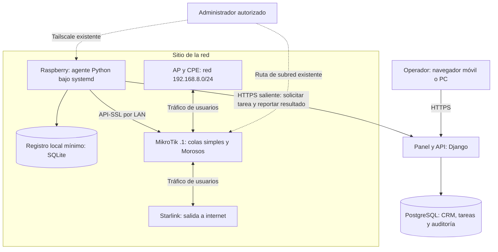

# Arquitectura propuesta

Diseño inicial, pendiente de pruebas. No contiene comandos de configuración ni código de aplicación.

Actualización del piloto: [red actual](red-actual.md) documenta RouterOS 6.49.23, IP fija por CPE como esquema inicial, colas simples y lista Morosos. [Adaptación a SpicyNet](adaptacion-spicynet.md) define el contrato operativo específico; este documento conserva la arquitectura general para otras redes y RouterOS 6/7.

## Componentes y caminos de comunicación



El diagrama es lógico: el cableado detallado se distingue de las relaciones de inventario en red actual. La Raspberry .90 ya figura como destino del portal y subnet router de mantenimiento; el agente sería un tercer servicio, sin sustituirlos. No se propone convertirla en gateway del tráfico normal de los clientes. Repetir el bloque de sitio permite incorporar otras redes administradas. Nodo Eleazar y Nodo Yolanda son dos ubicaciones dentro del sitio piloto, no dos routers independientes.

La disponibilidad de Tailscale para mantenimiento sigue dependiendo de la Raspberry que anuncia la subred. Si el agente falla pero la Raspberry y Tailscale funcionan, puede haber acceso remoto; si cae toda la Raspberry, se pierde también ese acceso salvo que exista una alternativa.

## Ciclo de una solicitud

```mermaid
sequenceDiagram
    actor Operador
    participant Panel
    participant DB as PostgreSQL
    participant Agente as Raspberry
    participant Router as MikroTik
    Operador->>Panel: Solicitar suspender un servicio
    Panel->>DB: Guardar intención, revisión y tarea en una transacción
    Panel-->>Operador: Pendiente; identificador de seguimiento
    Agente->>Panel: Consultar y reclamar tarea asignada
    Panel->>DB: Reclamar con vencimiento temporal
    Panel-->>Agente: Acción validada, revisión y vencimiento
    Agente->>Router: Leer estado y comprobar destino
    Agente->>Router: Aplicar cambio permitido si corresponde
    Agente->>Router: Consultar estado resultante
    Agente->>Agente: Persistir resultado mínimo
    Agente->>Panel: Informar resultado e intento
    Panel->>DB: Guardar resultado y auditoría
    Panel-->>Operador: Estado observado y hora de comprobación
```

## Contrato conceptual de tareas

Cada tarea necesita identificador único, organización/sitio/router/servicio, acción permitida, parámetros tipados, revisión del servicio, solicitante, fecha de creación, vencimiento, intentos y versión del contrato. La respuesta del agente incluye identificador de intento, resultado, evidencia mínima saneada y hora de observación. No devolver contraseñas ni exportaciones completas.

Las acciones iniciales son aprovisionar, suspender, reactivar y cambiar plan. El servidor valida los límites de velocidad y que el operador tenga acceso al sitio. El agente solo acepta routers y operaciones de su inventario local. El navegador nunca obtiene credenciales del router.

## Entrega, orden y recuperación

- La entrega puede repetirse. No se promete ejecución “exactamente una vez”. Cada operación debe llevar al estado solicitado sin duplicar objetos.
- Reclamar tareas usa una transacción breve con bloqueo de fila y un plazo de concesión. No se mantiene la transacción abierta durante las llamadas al router.
- Ejecutar una tarea por router a la vez. Usar una única instancia activa del agente por sitio en el MVP; no reasignar a un agente sustituto mientras pueda seguir actuando la instancia anterior. Un identificador de intento protege los reportes, pero MikroTik no ofrece con ello un bloqueo distribuido de escritura.
- Una revisión creciente por servicio impide que una suspensión antigua anule una reactivación reciente. Revalidar revisión y vencimiento antes de escribir. Si cambia la intención durante una llamada ya iniciada, finalizar la comprobación y converger a la revisión actual; no se puede retirar una llamada que el router ya recibió.
- Antes de reintentar un cambio tras un timeout, leer el estado real. Si el destino no puede identificarse con certeza o hay conflicto, detener y pedir revisión.
- El registro local conserva identificador/revisión y resultados pendientes de entrega; después de reiniciar siempre se vuelve a comprobar el router. No considerar ese registro prueba suficiente de que el estado continúa igual.
- Reintentos con espera creciente y límite; propuesta inicial de cinco intentos. El vencimiento depende de la operación y debe configurarse antes del piloto. No ejecutar órdenes vencidas al recuperar conexión.
- Si el router cambia pero el reporte se pierde, el agente reenvía el resultado. El servidor deduplica reportes y rechaza intentos obsoletos. Si no puede reconstruirse el resultado, mostrar “requiere verificación”.

Estados de tarea: pendiente, reclamada, aplicando, verificada, fallida, vencida, cancelada y requiere verificación. Los reintentos son intentos de una misma tarea. “Verificada” indica que se leyó la configuración técnica esperada; las pruebas del piloto agregan comprobación desde un cliente para demostrar el efecto real.

Si se cae el panel o Starlink, MikroTik conserva su configuración. No se crean cortes por falta de conexión al panel. En el MVP no se programan suspensiones automáticas autónomas en la Raspberry.

## Modelo de datos mínimo

| Entidad | Datos y relación principal |
|---|---|
| Organización y usuario | Propietario, rol y sitios permitidos |
| Sitio | Nombre, ubicación descriptiva y responsables |
| Nodo físico | Ubicación dentro del sitio; contiene equipos; no requiere agente propio |
| Agente | Sitio, identidad, versión y último contacto |
| Router | Sitio, agente asignado, modelo y versión observada |
| Equipo y enlace | AP, estación, CPE o infraestructura; IP de gestión, nodo, relación aguas arriba y evidencia/estado de confirmación |
| Cliente | Nombre, contacto y notas con acceso restringido |
| Servicio | Cliente, router, CPE/AP, IP de servicio, método de acceso, referencia a cola y restricción, plan, revisión y estados deseado/observado |
| Plan | Nombre, subida/bajada y burst opcional con unidades explícitas; condición comercial FREE separada del límite técnico |
| Política compartida | Cola general, horario o política de bloqueo del sitio; no se modela como un cliente |
| Tarea e intento | Intención, ejecución, vencimiento, resultado y evidencia |
| Evento de auditoría | Actor, motivo, servicio, cambio solicitado y resultado |

IP y MAC son atributos técnicos, no identificadores permanentes del cliente. No utilizar únicamente el índice temporal de una lista RouterOS para localizar objetos. Resolver una referencia estable y comprobar su unicidad antes de modificar. La adopción de objetos existentes requiere asociación revisada; etiquetar objetos nuevos y no apropiarse automáticamente de reglas de terceros.

## Aplicar acceso según la red existente

| Método detectado | Tratamiento que habrá que validar |
|---|---|
| SpicyNet: IP fija, cola simple y Morosos | Primer adaptador: adoptar colas individuales, activar/desactivar restricciones por IP y preservar orden, burst y políticas compartidas; comprobar portal aparte |
| PPPoE con usuarios locales | Asociar el servicio al usuario; suspensión debe impedir nueva autenticación y terminar la sesión correspondiente si está activa; comprobar plan/perfil sin modificar perfiles compartidos |
| DHCP o IP fija | Identificar de forma fiable el tráfico de ese abonado; definir bloqueo IPv4/IPv6 y velocidad en reglas/colas compatibles con su configuración |
| HotSpot | Validar usuario, sesión activa y posibles métodos de reconexión; requiere adaptador específico |
| RADIUS existente | Integrar con la autoridad actual; no crear usuarios locales que eviten la política central |

No basta con eliminar una concesión DHCP para garantizar suspensión. No basta con deshabilitar una cola: podría eliminar el límite de velocidad. Revisar FastTrack, orden de firewall, conexiones establecidas, IPv6 y posibles rutas alternativas. Las pruebas deben usar tráfico nuevo y sesiones ya abiertas, sin limpiar globalmente conexiones de otros clientes.

En el export SpicyNet no hay reglas FastTrack y las entradas Morosos están deshabilitadas. No deben alterarse las colas de Casa/Raspberry ni las generales. El orden de colas y los schedulers nocturnos forman parte del comportamiento vigente. La falta de una excepción explícita para el HTTP redirigido al portal exige validar el recorrido antes de ofrecer esa función como operativa. La presencia de reglas DNS permitidas significa que la política actual es restricción con excepciones, no aislamiento absoluto.

Fuentes de las capacidades a validar: [PPP AAA](https://manual.mikrotik.com/docs/authentication-authorization-accounting/ppp-aaa/), [FastTrack y connection tracking](https://help.mikrotik.com/docs/spaces/ROS/pages/130220087/Connection%2Btracking), [RADIUS](https://manual.mikrotik.com/docs/authentication-authorization-accounting/radius/). La lógica exacta sobre RouterOS 6 debe comprobarse con su configuración y comportamiento, ya que los manuales actuales incluyen funciones de RouterOS 7.

## Controles operativos

Identidad revocable por agente y alcance por sitio; credenciales MikroTik locales, fuera del repositorio y de logs; usuario RouterOS dedicado con las políticas mínimas comprobadas. RouterOS no debe suponerse capaz de restringir ese usuario a un único cliente: complementar permisos con firewall, restricción de origen y la lista de operaciones del agente.

HTTPS y API-SSL con certificados verificados. Sesiones humanas protegidas con CSRF y permisos del lado del servidor. Registrar motivo y actor de cada cambio. Limitar intentos de acceso y solicitudes. No permitir órdenes arbitrarias ni destinos suministrados libremente por el navegador.

Respaldar PostgreSQL y probar restauración. Rotar logs y limitar escrituras en la microSD. Antes de un cambio real conservar la configuración previa pertinente y un procedimiento de reversión; la compensación se aplica solo si no hay una revisión posterior. Nunca restaurar automáticamente toda la configuración del router por un fallo individual.
