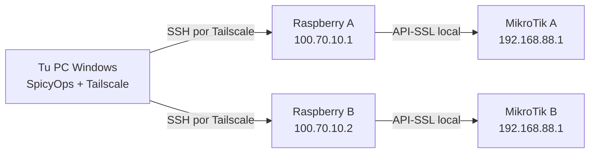
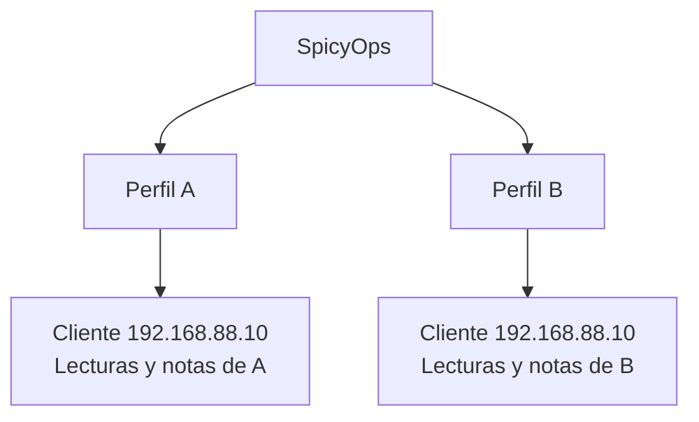
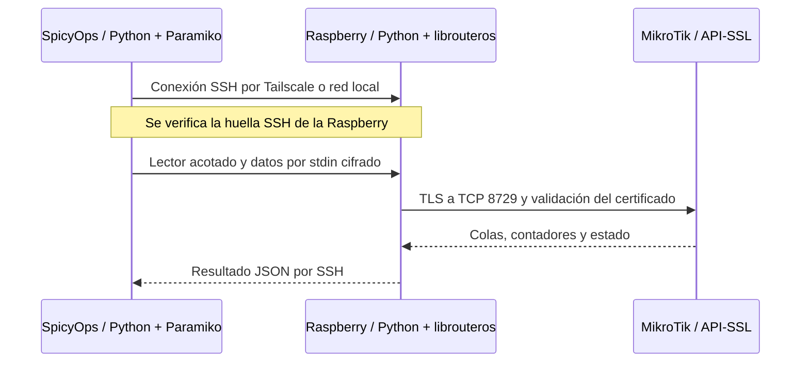
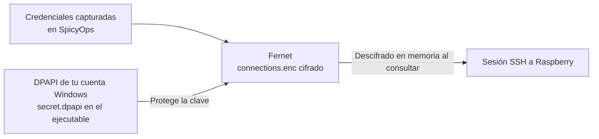
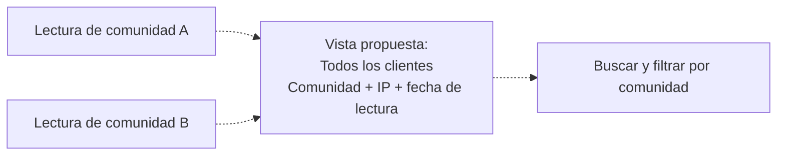

# SpicyOps: guía visual de conexiones y tecnologías

Fecha: 17 de octubre de 2026. Las direcciones son ejemplos, no datos de una instalación real.

## 1. Varias Raspberry en la misma red de Tailscale

Tu PC y las Raspberry pueden pertenecer a la misma red privada de Tailscale (tailnet). No necesitas cambiar de cuenta ni de VPN para consultar otra comunidad. Los equipos deben estar conectados y sus políticas deben permitir el acceso.

En SpicyOps agregas un perfil por localidad con la dirección de su Raspberry y el acceso a su MikroTik. Cambias de localidad dentro del programa. Que ambas sean accesibles no significa que SpicyOps mantenga sesiones permanentes o monitoree continuamente: abre una sesión al realizar una operación.

## 2. IP y credenciales repetidas

| Dato | Comunidad A | Comunidad B |
|---|---|---|
| IP Tailscale de Raspberry | 100.70.10.1 | 100.70.10.2 |
| IP local del MikroTik | 192.168.88.1 | 192.168.88.1 |
| IP de un cliente | 192.168.88.10 | 192.168.88.10 |
| Perfil en SpicyOps | Identificador propio A | Identificador propio B |

Las IP privadas y credenciales pueden repetirse sin mezclar los datos: cada perfil conserva sus lecturas y notas. Usar contraseñas distintas reduce el impacto si una se filtra. La clave es que cada perfil llegue a la Raspberry correcta y esta consulte al MikroTik correspondiente.

Este diseño no requiere anunciar ni unir las subredes de clientes por Tailscale: la consulta al router ocurre desde su propia Raspberry.

## 3. SSH a Raspberry y API-SSL a MikroTik

No usamos SSH directamente al MikroTik. Paramiko conecta desde Windows a la Raspberry por el puerto SSH configurado, normalmente 22. El lector utiliza Python y librouteros ya disponibles en la Raspberry y consulta la API-SSL del router por TCP 8729. No instala archivos ni servicios remotos.

### ¿La API se publica en internet?

La API funciona en el MikroTik; la Raspberry es el punto desde donde se consulta. SpicyOps no publica esa API, no abre puertos, no cambia firewall y no anuncia rutas. Tailscale instalado en la Raspberry no publica por sí solo la API del MikroTik.

La exposición efectiva depende de la configuración previa del router. Otros equipos podrían alcanzar la API si las restricciones del servicio, las rutas y el firewall lo permiten. TLS cifra la conexión, pero no limita por sí solo quién puede intentar acceder. Para aislarla se restringen los orígenes permitidos y el firewall. Este documento no acredita que esas restricciones estén aplicadas en una red física.

Conectar y sincronizar son de lectura. La excepción implementada es Morosos, con confirmación del operador y permisos: solo agregar o habilitar/deshabilitar una entrada individual en esa lista fija, validando el inventario y leyendo el resultado. No modifica reglas ni planes.

## 4. Tecnologías y contraseñas

| Pieza | Tecnología | Función |
|---|---|---|
| Aplicación Windows | Python, Django, Waitress y ventana de Edge | Interfaz y servidor local en 127.0.0.1 |
| Conectividad privada | Tailscale | Llegar a cada Raspberry desde tu PC |
| Acceso remoto | Paramiko sobre SSH | Autenticar y ejecutar el lector en Raspberry |
| Consulta del router | librouteros sobre API-SSL | Leer MikroTik con certificado validado |
| Estado local | Fernet | Cifrar perfiles y datos en connections.enc |
| Protección de clave en el ejecutable | DPAPI de Windows | Proteger secret.dpapi bajo la cuenta Windows |

El ejecutable guarda el estado en `%LOCALAPPDATA%/SpicyOps`. Las contraseñas no se guardan en cookies ni en un archivo remoto de credenciales. Al desconectar una localidad se eliminan del perfil, conservando lecturas y notas; esto no equivale a borrado forense de copias anteriores. Al ejecutar fuentes, la configuración permite `secret.key` sin DPAPI. Un proceso malicioso bajo tu cuenta Windows podría acceder a los secretos en uso.

## 5. Todas las comunidades: ampliación propuesta

La versión revisada permite configurar varias localidades y ver una localidad a la vez en Clientes y Analytics. Una vista conjunta aún no está implementada.

La propuesta mostraría la comunidad en cada fila, filtros y fecha de lectura. Si una localidad falla, su última lectura debería aparecer como desactualizada. Las acciones seguirían confirmando comunidad, cliente e IP. Una tabla conjunta no equivale a monitoreo en tiempo real; la actualización automática sería otra función por implementar.

## 6. Capacidad de Tailscale

La tarifa Personal consultada anuncia dispositivos asociados a usuarios ilimitados, hasta 6 usuarios y 50 recursos etiquetados incluidos. El plan Personal está destinado a uso no comercial. Para administrar una red de venta de internet hay que revisar el plan empresarial aplicable. Los límites pueden cambiar y deben consultarse antes de contratar o ampliar.

## Fuentes y alcance de la revisión

- [Tailscale: conectar equipos](https://tailscale.com/docs/how-to/connect-to-devices).
- [Tailscale: direcciones IP](https://tailscale.com/docs/concepts/ip-and-dns-addresses).
- [Tailscale: planes, límites y uso personal](https://tailscale.com/pricing).
- [MikroTik: servicios y restricciones de acceso](https://help.mikrotik.com/docs/spaces/ROS/pages/103841820/Services).
- Código del proyecto: `portal/connector.py`, `portal/remote_reader.py`, `portal/views.py`, `portal/store.py`, `portal/secret.py`, `spicyops/portal_settings.py`; README y encargo vigente.

Los diagramas explican la arquitectura del software. Para elaborar esta guía no se realizaron conexiones a equipos reales, modificaciones de red ni comprobaciones físicas de acceso o bloqueo.
