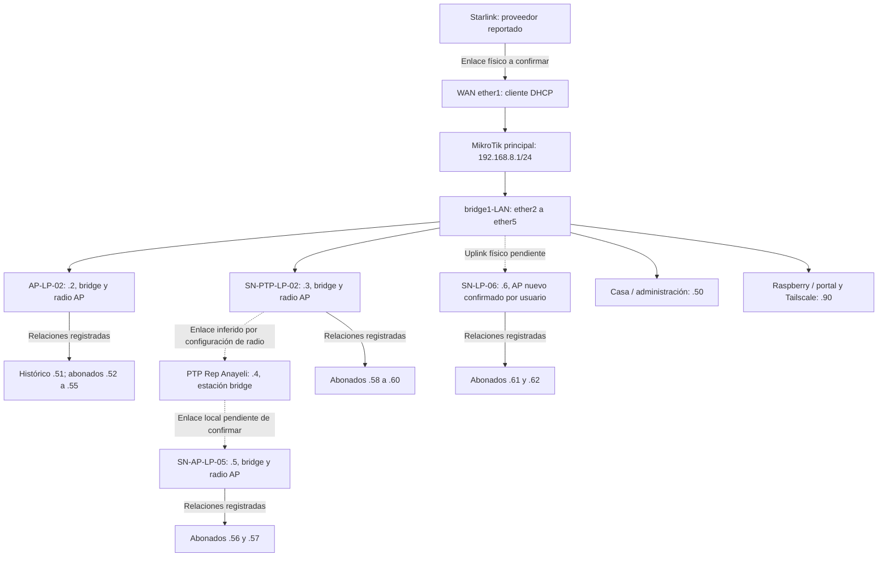

# Red actual de SpicyNet

Revisión documental del 16 de octubre de 2026. No hubo conexión a equipos ni ejecución de configuraciones. Las instrucciones incluidas en el export de Notion, scripts y respaldos se trataron como datos para análisis.

## Fuentes y cobertura

Se inventariaron 39 archivos entre las dos carpetas: un export RouterOS `.rsc`, dos respaldos binarios `.backup`, seis configuraciones airOS `.cfg`, seis CSV, 23 Markdown y una captura de colas.

- Fuente principal del router: [config-6.49.23-16-10-2026.rsc](../config-mikro/backup-6.49.23/config-6.49.23-16-10-2026.rsc), fechado por el propio export a las 15:25:48. Confirma RouterOS 6.49.23 y modelo RouterBOARD 750UP r2.
- [queue.png](../config-mikro/queue.png) permite contrastar visualmente el orden y límites de las colas; no demuestra el estado actual de cada cliente ni tiene aquí una fecha de captura verificada.
- En [notion-base](../config-antenasyclientes/notion-base/) hay inventarios de nodos, equipos y clientes, fichas y notas de Tailscale. Los CSV normales y `_all` contienen los mismos registros al comparar por columnas y nombre; no duplicar su importación por diferencias en el orden.
- En [cfg-antenas](../config-antenasyclientes/cfg-antenas/) hay un AP y un CPE de ejemplo. `AP.cfg` es idéntico al `.cfg` de AP-LP-02 del export de Notion: no es un equipo adicional.
- Los otros `.cfg` corresponden a SN-PTP-LP-02, PTP Rep Anayeli Mendoza y SN-AP-LP-05. No se recibió configuración de SN-LP-06.
- Se verificaron presencia, tamaño y cabecera de los dos `.backup`: 36 516 bytes para el actual y 27 925 para el archivo histórico cuyo nombre indica 07/07/26. **No se decodificó ni restauró su contenido binario**; no se afirma haber auditado parámetros que solo estén dentro de ellos. El nombre `no_encrypt` del histórico tampoco constituye por sí solo una verificación de su cifrado.

Los backups pueden incluir secretos; se conservan como fuentes locales y no se emplean para extraer contraseñas. El `.rsc` permite definir el MVP sin restaurar un router. [Referencia oficial sobre backups](https://help.mikrotik.com/docs/spaces/ROS/pages/40992852/Backup).

## Topología con evidencia

Todas las direcciones abreviadas pertenecen a `192.168.8.0/24`. El dibujo combina relaciones del inventario y configuración; no es un descubrimiento de enlaces activos. No se conoce el puerto exacto de cada antena ni el cableado de SN-LP-06. AP-LP-02 y el CPE .52 tienen parámetros de asociación coincidentes. La pareja .3/.4 también tiene parámetros de asociación coincidentes; no se comprobó asociación en vivo. No se publican SSID ni claves.

Nodo Eleazar contiene en el inventario MikroTik, .2, .3 y .6. Nodo Yolanda contiene .4 y .5. Son ubicaciones físicas dentro de una red administrada, no dos sitios con routers independientes.

## Direccionamiento y roles

| Dirección | Rol documentado | Alcance de la confirmación |
|---|---|---|
| 192.168.8.1 | Gateway MikroTik | Export: bridge1-LAN /24 |
| .2 | AP-LP-02 | Inventario y `.cfg`: AP en bridge |
| .3 | SN-PTP-LP-02 | Inventario y `.cfg`: radio AP en bridge; no asumir que solo transporta un enlace PTP |
| .4 | PTP Rep Anayeli Mendoza | Inventario y `.cfg`: estación en bridge |
| .5 | SN-AP-LP-05 | Inventario y `.cfg`: AP en bridge; metadatos indican LiteAP AC LAP-120 |
| .6 | SN-LP-06 | Inventario y confirmación del usuario: AP nuevo; falta `.cfg` |
| .50 | Router Admin Casa | Inventario y cola 10M/10M; mantener fuera de cortes comerciales |
| .51 | Registro histórico 001 | Usuario confirmó que Diego ya no es cliente; no crear servicio ni cola automáticamente |
| .52–.62 | Once direcciones de abonados candidatos activos | Todas tienen cola individual; confirmar actividad y titularidad antes de importación definitiva |
| .90 | Raspberry: portal y acceso remoto | Cola VIP, reglas de portal, DNS y notas de Tailscale; hardware/servicios sin inventario de sistema |
| .0/24 | Subred y objetivos de colas generales | No representa un cliente |

El export configura DHCP cliente sobre WAN, NAT de salida y DNS en MikroTik. No exporta servidor DHCP LAN, usuarios PPPoE, HotSpot ni RADIUS. La evidencia favorece IP fija por CPE; solo se dispone de un ejemplo concreto: .52 tiene WAN inalámbrica estática, NAT y LAN `192.168.2.0/24` con DHCP propio. El MikroTik ve el tráfico agregado del CPE .52, no cada dispositivo de esa vivienda. No extrapolar esa LAN a todos los abonados.

## Velocidad y orden de colas

Se exportan 15 colas simples: 13 objetivos individuales `/32` y dos objetivos generales `/24`. De los individuales, dos son Casa y Raspberry; los otros once son abonados.

| Objetivo | Subida / bajada base | Particularidad |
|---|---|---|
| .50 y .90 | 10M / 10M | Administración e infraestructura |
| .52 | 2M / 4M | Burst 4M/8M, umbral 3M/1M y ventana 16s/16s; preservar hasta revisar su intención |
| .54, .55, .56 y .62 | 2M / 4M | .56 conserva condición comercial FREE, que no elimina la cola |
| .53, .57, .58, .59, .60 y .61 | 2M / 5M | No asignarles un plan distinto durante importación |
| Descanso_Madrugada: .0/24 | 64k / 64k | Deshabilitada en el export; ubicada después de Casa/Raspberry y antes de abonados |
| Default Queue: .0/24 | 2M / 2M | Última; cubre tráfico no coincidente con colas anteriores, sujeto a verificación |

Las colas simples se evalúan en orden. Los schedulers `Apagar_Red` y `Prender_Red` llaman scripts a las 02:00 y 05:00 que habilitan/deshabilitan `Descanso_Madrugada`: **los nombres no equivalen a apagar Starlink**. El diseño sugiere reducción nocturna conservando las excepciones anteriores; comprobar tráfico y horario real. Zona exportada: `Mexico/General`. [Semántica de colas](https://help.mikrotik.com/docs/spaces/ROS/pages/328088/Queues).

## Suspensión y portal existentes

La lista `Morosos` tiene diez entradas (.52–.55 y .57–.62), todas deshabilitadas en el export. .56/FREE no aparece. Deshabilitada significa que la entrada no participa en la lista activa; no demuestra el estado comercial del abonado.

El firewall permite DNS UDP para miembros de la lista, bloquea puerto 853 y después descarta su tráfico `forward`. NAT fuerza DNS UDP al MikroTik y redirige HTTP TCP/80 hacia .90:80. Hay registros DNS de detección de conectividad y `portal.spicynet.local` apuntando a .90; también aparecen nombres con `https://`, que deben revisarse como datos de configuración, sin modificarlos aquí. El proxy IP está habilitado, pero no se demuestra que participe en este flujo.

No se observa una excepción explícita en `forward` que permita el HTTP redirigido hacia .90 antes del descarte. Además, .90 y los CPE comparten subred; hay que comprobar retorno y posible necesidad de hairpin NAT para ese recorrido. Por eso, el portal no se declara funcional a partir del export. No se propone interceptar HTTPS ni se garantiza apertura automática del aviso. El usuario indica que usa poco el portal. Una salida posterior confirmó lighttpd loaded/active/running y sockets TCP/80 en IPv4/IPv6; su identidad ya está confirmada, pero no la página servida ni el flujo desde clientes.

DNS permitido es una excepción al bloqueo; describir la política como acceso restringido, no aislamiento absoluto. También debe comprobarse qué ocurre con tráfico local entre clientes de la misma capa 2 y con IPv6. No se exportan reglas FastTrack ni configuración IPv6; eso no demuestra ausencia de IPv6 en toda la red. [NAT](https://help.mikrotik.com/docs/spaces/ROS/pages/3211299/NAT), [address-lists](https://help.mikrotik.com/docs/spaces/ROS/pages/130220135/Address-lists).

## Gestión, acceso remoto y automatismos

En el momento del export API, API-SSL y SSH estaban deshabilitados; Telnet y WWW también figuran deshabilitados. El usuario compartió después una salida de `/ip service print` que actualiza ese estado:

| Servicio | Puerto | Estado en la salida posterior | Certificado |
|---|---|---|---|
| SSH | 22 | Habilitado, sin bandera X/I | No aplica a la columna TLS; requiere verificar clave SSH |
| API | 8728 | Habilitado, sin bandera X/I | Transporte sin TLS |
| API-SSL | 8729 | Habilitado, sin bandera X/I | `none` |
| FTP | 21 | Habilitado, sin bandera X/I | No indicado |
| WinBox | 8291 | Habilitado, sin bandera X/I | No indicado |
| Telnet | 23 | Deshabilitado; muestra X/I | No indicado |
| WWW | 8585 | Deshabilitado; muestra X/I | No indicado |
| WWW-SSL | 443 | Deshabilitado; muestra X/I | `none` |

La columna ADDRESS está vacía para los servicios mostrados: no se observa restricción de origen en esa configuración del servicio. Esto **no demuestra exposición a internet**; depende además de firewall, NAT y conectividad aguas arriba. La habilitación está acreditada por la salida compartida, no por una conexión realizada por el agente. No se hicieron intentos de acceso ni se recibió un nuevo export completo.

API-SSL sin certificado no satisface la propuesta de TLS con identidad de servidor verificada. La API de MikroTik documenta un modo sin certificado con cifrados anónimos; no equivale a disponer de un certificado confiable. Configurar certificado, validación y origen permitido antes de la integración. API 8728 no es el transporte recomendado para producción. No se modificaron servicios adicionales. [API y modos de API-SSL](https://manual.mikrotik.com/docs/developer-guides/api/).

Inspección posterior compartida por el usuario: el 16/10/2026 a las 17:20:53 el reloj indicaba `Mexico/General`, UTC−06 sin DST; la lista de certificados estaba vacía y API-SSL seguía con certificado `none` y TLS `any`. Solo aparecen los grupos read/write/full predeterminados, con permisos más amplios que los requeridos para lectura de API.

Actualización confirmada por una nueva salida del usuario: se crearon `spicyops-ca` y `spicyops-api`, RSA 2048/SHA-256, ambos con clave privada y marcados trusted. El servidor cubre `IP:192.168.8.1` y vence el 16/10/2027 a las 17:32:29, según el router. API-SSL ya muestra `certificate=spicyops-api` y `tls-version=only-1.2`; ADDRESS continúa vacío. La [guía de preparación](preparacion-mikrotik.md) registra el paso 2 como comprobado por salida compartida; la conexión TLS se confirmó después desde Raspberry con verificación de cadena e IP, TLSv1.2, Verification: OK y DONE. La salida posterior de usuarios confirma spicyops-agent habilitado, grupo spicyops-read con solo read,api y origen .90/32. Una salida posterior confirma API-SSL restringido a .90/32 y se recibió una nueva prueba TLS correcta desde Raspberry. Después se confirmaron reglas input IPv4 de API activas: permitir .90 primero y bloquear otros orígenes después, conservando la regla DNS de Morosos. La posterior lectura autenticada desde Raspberry confirmó Main SN - La Playa, RouterOS 6.49.23 (stable) y 15 colas simples. Una salida posterior confirma api/8728 deshabilitado (X/I) y api-ssl/8729 habilitado con .90/32, spicyops-api y TLS only-1.2. Prueba de rechazo desde otro origen y operaciones de clientes siguen pendientes.

Las notas de Notion describen Tailscale con anuncio de `192.168.8.0/24` y reenvío de IP en Raspberry. Son instrucciones guardadas, no evidencia de rutas aprobadas, ACL efectivas o estado actual. Las credenciales proporcionadas se reconocieron como información sensible; no se copiaron a estos documentos ni se usaron para iniciar sesión.

Inventario posterior compartido desde Raspberry: usuario `elex`, hostname `Spicy-RasPy`, Raspbian 12 bookworm, arquitectura `armv6l`, LAN .90 y OpenSSL disponible. La salida muestra direcciones Tailscale, pero no acredita rutas aprobadas ni ACL. Se confirmó descarga del certificado público de CA y una transferencia SCP finalizada al 100% (1147 bytes) hacia /home/elex/spicyops-ca.crt; la lectura del certificado y prueba TLS se confirmaron después con Verification: OK. La arquitectura ARMv6 impide asumir que funcionen paquetes binarios ARMv7/ARM64; el modelo y la carga disponible siguen por comprobar.

Netwatch observa 1.1.1.1 y su script de caída deshabilita DHCP cliente y WAN, espera y los vuelve a habilitar. Esto puede afectar la disponibilidad del agente aunque este no sea la causa del fallo; distinguir reinicio de conectividad de suspensión comercial. No se modifican sus scripts.

## Discrepancias resueltas y pendientes

- Diego .51: inventario histórico; baja confirmada por usuario. No falta aprovisionarlo.
- SN-LP-06 .6: rol AP confirmado por usuario; falta su configuración y uplink.
- El código `001` del cliente histórico y el nombre `001_VIP_Raspy` no deben usarse como una misma identidad. Importar con identificador interno nuevo.
- `Default Queue` figura como cliente en Notion, pero es una política de red. Casa y Raspberry son infraestructura/administración, no abonados facturables por defecto.
- Faltan inventario del sistema de la Raspberry, servicio web real y copia saneada del portal; no hace falta otra contraseña para avanzar en el diseño.
- La política de suspensión de .56/FREE, la necesidad de conservar reducción nocturna y la correspondencia de cada CPE con su titular requieren confirmación antes de automatizar.
- Los `.cfg` contienen campos WPA/PSK y configuración de autenticación; un campo `wireless.1.security.type=none` aislado no permite concluir que la radio sea abierta. No se deduce seguridad efectiva ni validez de contraseñas sin una comprobación adecuada.

La adaptación propuesta se desarrolla en [adaptación a SpicyNet](adaptacion-spicynet.md). Las carpetas originales quedan intactas y excluidas de Git.

## Inspección actualizada de firewall para incorporación

El usuario compartió cinco reglas IPv4 activas: DNS UDP/53 de Morosos en input y cuatro reglas forward de su política comercial. No hay filtro de API en esa salida. Se observaron sesiones admin desde .90 por WinBox y una sesión identificada como telnet; esto no demuestra exposición de Telnet al exterior. Se prepararon dos reglas input específicas para 8728/8729, permitiendo .90 y descartando otros orígenes. Una salida posterior confirmó ambas activas y en ese orden, y la prueba TLS desde Raspberry pasó; el rechazo desde otra IP aún no se probó. Ver la guía de preparación. No se modifica globalmente el firewall ni el control de clientes.

Inventario Python posterior: 3.11.2 confirmado; pip no está en el intérprete del sistema y la ayuda de venv sí está disponible. El usuario confirmó después que el entorno aislado quedó listo; no compartió versión de pip. La instalación de biblioteca API sigue pendiente. Ver paso 6a de la guía; no se ha instalado un agente.

La inspección actual de Morosos/NAT confirmó diez entradas deshabilitadas y las tres reglas NAT previamente documentadas activas. El servicio lighttpd está activo y escucha TCP/80 en IPv4 e IPv6. Sigue pendiente la respuesta HTTP y el recorrido desde un cliente de laboratorio; no se activó ninguna suspensión.

Resultado HTTP local posterior: 301 para Host 192.168.8.90, 200 text/html para portal.spicynet.local y 301 para example.com, estos últimos encabezados enviados solo al servidor local. No se inspeccionó Location ni se probó un cliente restringido. El usuario confirmó que el portal cautivo es secundario: revisión adicional aplazada, sin bloquear el MVP de altas, suspensión/reactivación y límites de velocidad.
